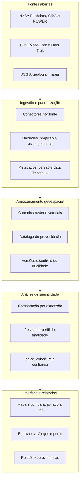

# PlanetLog

Plataforma de inteligência geoespacial para identificar, analisar e comparar ambientes terrestres análogos à Lua e a Marte.

**Membros:**

Danilo Bomfim Moreira Junio
Leonardo Pimentel Santos de Araujo
Luan Morais Galdino
Lucas Oliveira Duarte
Matheus Machado de Oliveira

## Resumo

O PlanetLog é uma plataforma de inteligência geoespacial que identifica, analisa e compara ambientes terrestres com características semelhantes às da Lua e de Marte. Ela integra dados abertos da NASA, do USGS e de instituições parceiras em um único ambiente analítico, cruzando geologia, mineralogia, topografia, temperatura, água e processos superficiais.

O resultado é uma comparação explicável: para cada par entre uma região terrestre e um alvo planetário, a plataforma apresenta o grau de similaridade, as evidências usadas, as divergências e o nível de confiança. O público-alvo inclui pesquisadores, estudantes, equipes de desenvolvimento aeroespacial e entusiastas, e o propósito é apoiar a preparação de futuras missões de exploração robótica e humana.

## 1. Introdução

### 1.1 Contextualização e motivação

A exploração da Lua e de Marte exige validar equipamentos, protocolos e hipóteses científicas antes do envio de sondas, rovers ou tripulações. Os análogos terrestres, regiões da Terra que compartilham traços geológicos, mineralógicos, topográficos ou climáticos com superfícies planetárias, funcionam como laboratórios naturais de baixo custo e fácil acesso.

Há, porém, um gargalo de informação. Os dados orbitais e ambientais necessários estão disponíveis gratuitamente, mas dispersos em bases heterogêneas, com formatos técnicos complexos e difíceis de integrar. Sem ferramentas que consolidem e cruzem esses parâmetros, a busca sistemática por análogos fica restrita a quem domina o processamento de dados geoespaciais.

### 1.2 A solução

O PlanetLog estrutura dados científicos de fontes abertas em um ambiente analítico unificado. Ao cruzar variáveis como geologia, mineralogia, topografia, temperatura, presença de água e condições ambientais, a plataforma avalia o grau de similaridade entre localidades terrestres e alvos extraterrestres de interesse.

### 1.3 Objetivo geral

Transformar dados científicos brutos em informação visual, estruturada e acessível, democratizando a análise geoespacial planetária e oferecendo suporte técnico-científico à identificação de ambientes análogos e ao planejamento de missões de exploração espacial.

### 1.4 Organização do documento

- **Seção 2 — Objetivos:** metas gerais e específicas da plataforma.
- **Seção 3 — Fundamentação científica:** conceito de análogo planetário, ambientes da Lua e de Marte, dimensões de comparação e limitações.
- **Seções 4 e 5 — Metodologia e fontes de dados:** processo analítico e bases utilizadas.
- **Seções 6 e 7 — Arquitetura e funcionalidades:** estrutura técnica e fluxo de uso.
- **Seções 8 a 10 — Estudo de caso, classificação de similaridade e validação:** aplicação, método de pontuação e critérios de avaliação.
- **Seções 11 e 12 — Limitações, trabalhos futuros e conclusão.**

## 2. Objetivos

O PlanetLog deve integrar dados científicos em um único ambiente e usá-los para identificar regiões terrestres análogas à Lua e a Marte, mostrando as evidências de cada correspondência e as diferenças que a limitam.

### 2.1 Objetivo geral

Desenvolver uma plataforma de inteligência geoespacial capaz de identificar e comparar ambientes terrestres com características semelhantes às de um corpo celeste alvo, usando dados geológicos, mineralógicos, topográficos e ambientais provenientes da NASA e de instituições parceiras.

### 2.2 Objetivos específicos

1. **Integrar e centralizar dados científicos.** Reunir imagens de satélite, modelos digitais de elevação, dados climáticos, registros geológicos, informações mineralógicas e observações de missões espaciais, reduzindo a fragmentação entre bases.
2. **Caracterizar ambientes terrestres.** Descrever cada região por geologia, mineralogia, topografia (elevação, declividade, rugosidade), temperatura, disponibilidade de água e gelo, poeira e vento, e condições de habitabilidade.
3. **Comparar ambientes terrestres e planetários.** Usar indicadores científicos compatíveis para apontar em quais dimensões uma região terrestre funciona como análogo, reconhecendo que uma forte semelhança geológica pode coexistir com diferenças atmosféricas, térmicas ou físicas.
4. **Identificar potenciais análogos com base em evidências.** Ir além da comparação visual, apoiando estudos científicos, testes de tecnologia e preparação de missões.
5. **Calcular e explicar a similaridade.** Quando os dados forem suficientes e metodologicamente compatíveis, aplicar métricas estatísticas, sempre expondo critérios, variáveis, pesos e limitações, sem classificações sem fundamento científico.
6. **Visualizar e interpretar informações geoespaciais.** Oferecer mapas, camadas, imagens, indicadores e comparações lado a lado que mostrem a distribuição espacial das características analisadas.

## 3. Fundamentação científica

Um ambiente análogo é uma região da Terra que reproduz, em parte, características de outro corpo celeste. O PlanetLog parte da premissa de que a analogia é sempre parcial e deve ser avaliada dimensão por dimensão.

### 3.1 Ambientes análogos planetários

Análogos são usados para estudar processos naturais, testar instrumentos, desenvolver tecnologias e simular condições de futuras missões. A exploração direta de outros corpos envolve custo, risco e limitação tecnológica elevados; na Terra é possível fazer trabalho de campo, coletar amostras e testar equipamentos em condições controladas ou parcialmente semelhantes.

Um análogo não precisa reproduzir todas as condições do alvo. Uma região pode se parecer com Marte em aridez, mineralogia e presença de sais e, ainda assim, diferir em pressão atmosférica, gravidade e radiação. Uma região vulcânica pode servir ao estudo de terrenos lunares apesar de não reproduzir o ambiente espacial. A utilidade de um local depende do objetivo da pesquisa: ele pode ser adequado para testar um amostrador e inadequado para simular o regime térmico de Marte.

A NASA já utiliza ambientes terrestres com essa finalidade. O Deserto do Atacama, no Chile, é estudado pela extrema aridez e pela baixa presença de microrganismos em certas áreas, o que permite investigar limites de sobrevivência microbiana e testar tecnologias de busca por bioassinaturas. Terrenos vulcânicos servem a treinamento geológico e avaliação de equipamentos.

### 3.2 Lua e Marte em comparação com a Terra

| Característica                            | Lua                                                   | Marte                                                                       | Terra                                                       |
| ----------------------------------------- | ----------------------------------------------------- | --------------------------------------------------------------------------- | ----------------------------------------------------------- |
| Atmosfera                                 | Exosfera extremamente tênue                           | Muito fina, predominantemente CO₂                                           | Densa, predominantemente N₂ e O₂                            |
| Gravidade superficial (aprox.)            | 1/6 da terrestre                                      | cerca de 38% da terrestre                                                   | referência                                                  |
| Temperatura superficial (referência NASA) | cerca de 127 °C (dia) a −173 °C (noite)               | cerca de 20 °C a −153 °C                                                    | varia por clima                                             |
| Água                                      | Gelo em crateras permanentemente sombreadas nos polos | Gelo polar e subterrâneo; água líquida no passado                           | Abundante e líquida                                         |
| Superfície                                | Maria basálticos, highlands, regolito e crateras      | Basaltos, óxidos de ferro, argilas, sulfatos, dunas, vales e canais antigos | Dinâmica, modificada por água, vento, vegetação e tectônica |
| Proteção contra radiação                  | Praticamente nenhuma                                  | Limitada                                                                    | Alta (atmosfera e campo magnético)                          |

Os valores de temperatura dependem de local, estação e horário, e devem ser tratados como referências de ordem de grandeza.

### 3.3 Características da Lua relevantes para análogos

- **Geologia e materiais:** os maria são planícies de antigos derrames basálticos, e as highlands têm composição e história distintas. O regolito, formado por impactos sucessivos e exposição ao ambiente espacial, tem propriedades próprias e não equivale a solo terrestre.
- **Topografia:** crateras, bacias, encostas e terrenos irregulares influenciam pouso e mobilidade; elevação, declividade, rugosidade e densidade de crateras são os parâmetros-chave.
- **Temperatura e iluminação:** sem atmosfera, a variação entre áreas iluminadas e sombreadas é extrema, e a iluminação é um fator de planejamento de bases.
- **Água e gelo:** evidências de voláteis em crateras permanentemente sombreadas dos polos; presença, quantidade e possibilidade de extração ainda dependem de confirmação.
- **Operações:** estabilidade do terreno, obstáculos, iluminação e recursos potenciais condicionam a escolha de locais de pouso e instalação.

Basaltos vulcânicos, áreas com material fragmentado e terrenos frios e rochosos da Terra ajudam a testar equipamentos e procedimentos, sem reproduzir vácuo nem exposição espacial.

### 3.4 Características de Marte relevantes para análogos

- **Geologia e mineralogia:** basaltos, minerais de ferro oxidado (origem da coloração avermelhada), argilas, sulfatos e depósitos sedimentares. A presença do mesmo mineral em dois locais não implica a mesma origem; é preciso considerar contexto geológico, processos de formação e alteração.
- **Topografia e geomorfologia:** crateras, planícies, vulcões, cânions, dunas, vales e canais antigos. Elevação, declividade, rugosidade, distribuição de crateras, rochas e obstáculos orientam pouso e navegação.
- **Temperatura e clima:** temperaturas baixas, com grande variação entre locais, estações e horas do dia; a atmosfera rarefeita retém pouco calor. Temperatura isolada não é análogo completo, pois pressão, composição gasosa, radiação e umidade também contam.
- **Água e gelo:** há evidência de rios, deltas e lagos antigos. Hoje a água ocorre sobretudo como gelo polar e subterrâneo, e a atmosfera fina dificulta água líquida estável.
- **Poeira, vento e processos atmosféricos:** transporte de partículas, dunas e tempestades de poeira afetam visibilidade, instrumentos, sistemas mecânicos e geração de energia. Desertos terrestres permitem estudar transporte e erosão, mas a dinâmica ocorre em atmosfera muito mais densa.
- **Biologia e habitabilidade:** condições semelhantes às de Marte não são evidência de vida em Marte. Ambientes extremos terrestres servem como referência experimental para desenvolver métodos e interpretar resultados de missões.
- **Ambientes subterrâneos:** cavernas, fraturas e tubos de lava podem preservar gelo, minerais e registros antigos e oferecer proteção parcial contra radiação e variação térmica.

### 3.5 Dimensões de comparação

A similaridade é avaliada em oito dimensões, nunca por aparência visual ou por uma única variável.

| Dimensão                               | Variáveis consideradas                                                                                                          | Cuidado metodológico                                                    |
| -------------------------------------- | ------------------------------------------------------------------------------------------------------------------------------- | ----------------------------------------------------------------------- |
| Geologia e mineralogia                 | Tipos de rocha e minerais, composição química, basaltos, argilas, sulfatos, sais, estruturas vulcânicas, crateras, intemperismo | Mesmo mineral não implica mesma gênese                                  |
| Topografia e geomorfologia             | Elevação, declividade, rugosidade, relevo, crateras, dunas, vales, obstáculos                                                   | Comparar na mesma escala espacial                                       |
| Temperatura e extremos                 | Média, máxima, mínima, amplitude, variação diária e sazonal, exposição solar                                                    | Não comparar temperatura do ar com temperatura da superfície sem ajuste |
| Água, gelo e voláteis                  | Água superficial, gelo, permafrost, umidade do solo, evaporitos, reservas subterrâneas                                          | Água presente não implica o mesmo mecanismo de preservação              |
| Poeira, vento e processos superficiais | Vento, transporte de sedimentos, erosão, dunas, partículas suspensas                                                            | Diferenças de pressão e densidade atmosférica                           |
| Biologia e habitabilidade              | Microrganismos, extremófilos, salinidade, radiação, pH, matéria orgânica, preservação de bioassinaturas                         | Analogia experimental, não evidência de vida                            |
| Cavernas e subterrâneo                 | Tubos de lava, fraturas, cavidades, gelo, camadas sedimentares, estabilidade e acesso                                           | Acesso e estabilidade variam por local                                  |
| Condições operacionais                 | Pouso e deslocamento, inclinação, obstáculos, visibilidade, comunicação, navegação, recursos, segurança                         | Depende do tipo de missão testada                                       |

### 3.6 Ambientes terrestres de interesse

| Ambiente                           | Principal utilidade                                                                                                                             | Limite da analogia                                                                                                           |
| ---------------------------------- | ----------------------------------------------------------------------------------------------------------------------------------------------- | ---------------------------------------------------------------------------------------------------------------------------- |
| Deserto do Atacama (Chile)         | Aridez extrema, salinidade, forte exposição solar, minerais evaporíticos, limites de vida microbiana, teste de instrumentos de detecção de vida | Atmosfera, gravidade, pressão, composição gasosa e radiação diferem de Marte; análogo parcial                                |
| Vales Secos de McMurdo (Antártida) | Frio e aridez, congelamento e sublimação, preservação de materiais, microbiologia extrema, testes em locais remotos                             | Não reproduz pressão, atmosfera nem gravidade de Marte                                                                       |
| Regiões vulcânicas da Islândia     | Campos de lava e basaltos, mobilidade de robôs, identificação mineralógica, relevo vulcânico                                                    | Interação com água e atmosfera diferente da lunar e marciana                                                                 |
| Mauna Kea e vulcões do Havaí       | Lavas basálticas, campos rochosos, grande altitude; treinamento geológico de astronautas do programa Apollo                                     | Ambiente úmido e erosão ativa                                                                                                |
| Crateras de impacto terrestres     | Morfologia de impacto, deformação de rochas, depósitos associados                                                                               | Água, vento, vegetação e tectônica alteram as estruturas, enquanto muitas crateras lunares se preservam por muito mais tempo |

### 3.7 Aplicação à exploração espacial

Ambientes análogos permitem testar mobilidade robótica (rochas, declives, areia, dunas), instrumentos de coleta e análise de amostras, sensores e sistemas de navegação, tecnologias de monitoramento ambiental e procedimentos de operação humana em locais remotos. Com isso, reduzem incertezas científicas e operacionais antes de missões reais.

### 3.8 Limitações dos análogos

Nenhum ambiente terrestre reproduz integralmente a Lua ou Marte. As diferenças principais estão em gravidade, atmosfera (pressão, transferência de calor, vento, propagação de partículas), radiação, mecanismos térmicos e processos geológicos e ambientais, já que na Terra água, atmosfera, vegetação e tectônica modificam continuamente a superfície. Por isso toda analogia deve ser declarada de forma específica: o que é semelhante, o que é diferente e para qual aplicação o local é útil.

## 4. Metodologia

A metodologia compara uma região terrestre e uma região lunar ou marciana por variáveis mensuráveis, em sete etapas que vão da seleção das áreas à interpretação científica. A comparação por aparência visual é descartada, pois paisagens parecidas podem ter composição e processos muito diferentes.

1. **Seleção das regiões de interesse.** Definir a área terrestre e a região lunar ou marciana a comparar, em recortes específicos e nunca em grandes áreas tratadas como homogêneas.
2. **Coleta de dados.** Obter variáveis geológicas, mineralógicas, topográficas, térmicas e ambientais nas fontes da seção 5.
3. **Padronização.** Converter os dados para unidades, escalas espaciais, projeções e períodos compatíveis, registrando resolução, método de aquisição e incerteza de cada camada.
4. **Análise por dimensão.** Comparar cada uma das oito dimensões da seção 3.5 separadamente.
5. **Identificação de correspondências.** Registrar as variáveis com semelhança relevante.
6. **Identificação de divergências.** Registrar as variáveis sem correspondência ou com diferença significativa, inclusive as inerentes à Terra (gravidade, atmosfera, radiação).
7. **Interpretação científica.** Avaliar para qual finalidade de pesquisa ou teste o local é útil, apresentando evidências, limitações e nível de confiança.

### 4.1 Princípios

- **Multidimensionalidade:** nenhuma conclusão baseada em uma única variável.
- **Rastreabilidade:** cada resultado aponta para a fonte, a versão do dado e a data de acesso.
- **Compatibilidade:** variáveis equivalentes são comparadas entre si, por exemplo temperatura de superfície com temperatura de superfície.
- **Transparência:** critérios, pesos, dados ausentes e incertezas são sempre exibidos junto ao resultado.
- **Dado ausente não é zero:** a falta de informação não significa ausência da característica.

## 5. Fontes de dados

O PlanetLog usa bases abertas da NASA e do USGS que cobrem a Terra, a Lua e Marte. Cada conjunto tem resolução espacial e temporal, unidade, método de aquisição e limitações próprios, que devem ser verificados antes de qualquer comparação.

| Fonte                            | Cobertura          | Uso no PlanetLog                                                                        |
| -------------------------------- | ------------------ | --------------------------------------------------------------------------------------- |
| NASA Earthdata                   | Terra              | Conjuntos de observação da Terra: relevo, temperatura, umidade, cobertura da superfície |
| NASA Worldview                   | Terra              | Visualização de imagens e camadas ambientais                                            |
| NASA GIBS                        | Terra              | Serviço de distribuição de imagens e camadas geoespaciais para o mapa                   |
| NASA POWER                       | Terra              | Variáveis meteorológicas e de energia solar, para o regime térmico e de vento           |
| NASA Planetary Data System (PDS) | Lua e Marte        | Dados científicos de missões planetárias: mineralogia, topografia, temperatura, gelo    |
| Moon Trek                        | Lua                | Visualização e consulta de dados e feições da Lua                                       |
| Mars Trek                        | Marte              | Visualização e consulta de dados e feições de Marte                                     |
| USGS                             | Terra, Lua e Marte | Informações geológicas, topográficas e cartográficas                                    |

### 5.1 Critérios de aceitação de um conjunto de dados

- Origem institucional e documentação pública do método de aquisição.
- Resolução espacial e temporal declaradas e adequadas à escala da comparação.
- Unidades e referenciais geodésicos conhecidos e convertíveis.
- Licença que permita uso e redistribuição de derivados.

Os endereços e versões de cada conjunto devem ser registrados na seção de referências ao fim da implementação.

## 6. Arquitetura do sistema

O PlanetLog é organizado em cinco camadas em que cada uma consome apenas a saída da anterior, de modo que todo resultado pode ser rastreado até a fonte e a versão dos dados.

Os dados chegam padronizados e versionados, o motor compara por dimensão e todo índice sai acompanhado de cobertura e confiança.

### 6.1 Camadas e responsabilidades

As tecnologias abaixo são candidatas e devem ser confirmadas pela equipe na fase de implementação.

| Camada                    | Responsabilidade                                                                          | Tecnologias candidatas                                       |
| ------------------------- | ----------------------------------------------------------------------------------------- | ------------------------------------------------------------ |
| Fontes abertas            | Disponibilizar dados da Terra, da Lua e de Marte                                          | NASA, USGS e instituições parceiras                          |
| Ingestão e padronização   | Coletar por conector, converter unidades, projeção e escala, registrar metadados e versão | Python com GDAL e rasterio; catálogo no padrão STAC          |
| Armazenamento geoespacial | Guardar camadas raster e vetoriais, catálogo de proveniência e controle de qualidade      | PostgreSQL com PostGIS; GeoTIFF otimizado para a nuvem (COG) |
| Análise de similaridade   | Comparação por dimensão, pesos por perfil, índice, cobertura e confiança (seção 9)        | Python com NumPy, SciPy e scikit-learn                       |
| Interface e relatórios    | Mapas, comparação lado a lado, busca de análogos e relatório de evidências, via API       | API REST; MapLibre GL JS ou CesiumJS para mapas e globos     |

### 6.2 Princípios de projeto

- **Rastreabilidade:** cada camada de dado guarda origem, versão e data de acesso.
- **Reprodutibilidade:** o mesmo conjunto de dados e a mesma configuração de pesos geram o mesmo resultado.
- **Explicabilidade:** o índice nunca é exibido sem variáveis, pesos, cobertura e confiança.
- **Extensibilidade:** novas fontes entram por conectores e novos alvos planetários por novos conjuntos de camadas, sem alterar o motor de análise.

## 7. Funcionalidades e fluxo de uso

O usuário escolhe uma região terrestre e um alvo planetário, e a plataforma devolve mapas, indicadores e uma comparação explicada por dimensão.

### 7.1 Funcionalidades

| Funcionalidade           | Descrição                                                                                                                           |
| ------------------------ | ----------------------------------------------------------------------------------------------------------------------------------- |
| Catálogo de dados        | Consulta unificada às fontes da seção 5, com origem, resolução, unidade e data de cada camada                                       |
| Exploração geoespacial   | Mapa interativo com camadas de elevação, declividade, temperatura, mineralogia, gelo e imagens de satélite, para Terra, Lua e Marte |
| Caracterização de região | Ficha de uma área com as oito dimensões da seção 3.5 e o que há de dado disponível em cada uma                                      |
| Comparação lado a lado   | Duas regiões, uma terrestre e uma planetária, em painéis sincronizados, com as variáveis alinhadas                                  |
| Busca de análogos        | Dada uma região lunar ou marciana, lista regiões terrestres candidatas ordenadas por similaridade                                   |
| Perfis de finalidade     | Pesos pré-definidos por objetivo (astrobiologia, mobilidade, geologia), ajustáveis pelo usuário                                     |
| Relatório de evidências  | Exportação com correspondências, divergências, limitações, cobertura de dados e nível de confiança                                  |

### 7.2 Fluxo de uso

1. Escolher o alvo (Lua ou Marte) e, se desejar, uma região específica dele.
2. Escolher ou desenhar a região terrestre, ou pedir à plataforma uma busca de candidatas.
3. Selecionar o perfil de finalidade e, opcionalmente, ajustar pesos e dimensões incluídas.
4. Visualizar o mapa e a comparação lado a lado, dimensão por dimensão.
5. Ler o resultado: similaridade por dimensão, índice global, cobertura de dados e confiança.
6. Abrir as evidências e as divergências, e exportar o relatório.

## 8. Estudo de caso: Atacama e Marte

O estudo de caso compara áreas específicas do Deserto do Atacama com regiões de Marte para mostrar que o mesmo local pode ser um bom análogo em algumas dimensões e fraco em outras. O Atacama não é tratado como ambiente homogêneo: o caso usa recortes, como áreas hiperáridas e depósitos salinos, definidos na fase de seleção.

### 8.1 Desenho do caso

1. Delimitar duas ou três áreas do Atacama e uma ou mais regiões marcianas de interesse com mineralogia e relevo comparáveis.
2. Reunir os dados de cada dimensão e padronizá-los conforme a seção 4.
3. Calcular a similaridade por dimensão, o índice global, a cobertura e a confiança (seção 9).
4. Registrar correspondências e divergências e produzir o relatório de evidências.

### 8.2 Expectativa por dimensão

A expectativa abaixo vem da fundamentação científica e funciona como hipótese a testar, não como resultado.

| Dimensão                               | Expectativa de analogia | Justificativa                                                             |
| -------------------------------------- | ----------------------- | ------------------------------------------------------------------------- |
| Biologia e habitabilidade              | Forte                   | Aridez extrema e baixa atividade microbiana em áreas específicas          |
| Água, gelo e voláteis                  | Média a forte           | Baixa disponibilidade de água e depósitos evaporíticos                    |
| Geologia e mineralogia                 | Média a forte           | Sais, evaporitos e minerais de ferro; depende da área                     |
| Poeira, vento e processos superficiais | Média                   | Forte ação eólica, mas em atmosfera muito mais densa                      |
| Temperatura e extremos                 | Média a fraca           | Aridez e radiação solar altas, mas amplitude térmica menor que a marciana |
| Condições operacionais                 | Média                   | Terrenos adequados a testes de mobilidade e instrumentos                  |
| Atmosfera, gravidade e radiação        | Fraca                   | Inerentes à Terra e não replicáveis no local (seção 3.8)                  |

### 8.3 Saídas esperadas

Mapas das áreas, perfil de similaridade por dimensão, relatório de evidências e uma recomendação de uso do Atacama por finalidade, por exemplo teste de instrumentos de detecção de vida em vez de teste de comportamento térmico.

## 9. Sistema de classificação de similaridade

A similaridade é calculada por dimensão e depois agregada em um índice global, que sempre vem acompanhado de cobertura de dados e confiança. O índice é uma estimativa dentro das variáveis e dos critérios usados, nunca uma prova de equivalência entre ambientes. Os valores de peso e de faixa abaixo são propostas iniciais, a calibrar na validação (seção 10).

### 9.1 Similaridade por variável e por dimensão

Cada variável k é normalizada para o intervalo [0, 1] em uma escala de referência comum aos dois ambientes, e sua similaridade é o complemento da distância normalizada. A similaridade de uma dimensão d é a média ponderada das variáveis com dado disponível.

$$
s_k = 1 - \min\left(1, \frac{|x_k^{T} - x_k^{P}|}{r_k}\right)
\qquad
S_d = \frac{\sum_{k \in K_d} v_k \, s_k}{\sum_{k \in K_d} v_k}
$$

Aqui $x_k^T$ e $x_k^P$ são os valores da variável na região terrestre e na planetária, $r_k$ é a amplitude de referência da variável e $K_d$ é o conjunto de variáveis da dimensão $d$ com dado disponível. Variáveis categóricas, como tipo de rocha ou mineral, usam correspondência por classe ou por hierarquia.

### 9.2 Índice global, cobertura e confiança

$$
S = \frac{\sum_{d \in D^{*}} w_d \, S_d}{\sum_{d \in D^{*}} w_d}
\qquad
C = \frac{\sum_{d \in D^{*}} w_d}{\sum_{d \in D} w_d}
$$

$D^*$ é o conjunto de dimensões com dado suficiente, $D$ é o conjunto das oito dimensões e $w_d$ é o peso da dimensão. $S$ varia de 0 a 1, e $C$ é a cobertura: a fração do peso total efetivamente avaliada.

Regras de tratamento:

- **Dado ausente não vale zero.** A dimensão ou variável sai do cálculo e reduz a cobertura C.
- **Cobertura mínima.** Abaixo de um limite de C (proposta inicial: 0,5) o índice global não é exibido, apenas os resultados por dimensão.
- **Confiança** por dimensão combina resolução espacial, compatibilidade de escala e período, qualidade do dado e incerteza, e é exibida como alta, média ou baixa.
- **Fatores não replicáveis**, como gravidade, pressão atmosférica e radiação, não entram na pontuação; são listados como divergências obrigatórias em todo relatório.

### 9.3 Pesos por perfil de finalidade

Os pesos relativos (3 = alto, 2 = médio, 1 = baixo) expressam a importância de cada dimensão para o objetivo da comparação e podem ser ajustados pelo usuário.

| Dimensão                               | Astrobiologia | Mobilidade e operações | Geologia e mineralogia |
| -------------------------------------- | ------------- | ---------------------- | ---------------------- |
| Geologia e mineralogia                 | 2             | 1                      | 3                      |
| Topografia e geomorfologia             | 1             | 3                      | 2                      |
| Temperatura e extremos                 | 2             | 2                      | 1                      |
| Água, gelo e voláteis                  | 3             | 1                      | 2                      |
| Poeira, vento e processos superficiais | 2             | 2                      | 2                      |
| Biologia e habitabilidade              | 3             | 1                      | 1                      |
| Cavernas e subterrâneo                 | 1             | 2                      | 2                      |
| Condições operacionais                 | 1             | 3                      | 1                      |

### 9.4 Faixas de interpretação

| Índice S       | Leitura                                              |
| -------------- | ---------------------------------------------------- |
| 0,75 a 1,00    | Analogia forte nas dimensões avaliadas               |
| 0,50 a 0,74    | Analogia parcial; verificar as dimensões divergentes |
| Abaixo de 0,50 | Analogia fraca para a finalidade escolhida           |

A leitura só vale junto de C e da confiança: S alto com C baixo indica pouca evidência, não boa analogia.

## 10. Resultados e validação

Esta seção define como o PlanetLog será avaliado; os resultados medidos devem ser registrados aqui após a execução do estudo de caso da seção 8. Nenhum resultado numérico é declarado antes disso.

### 10.1 Plano de validação

| Nível         | O que se verifica                                                            | Método                                                                                                                             |
| ------------- | ---------------------------------------------------------------------------- | ---------------------------------------------------------------------------------------------------------------------------------- |
| Dados         | Integridade, unidades, georreferenciamento e compatibilidade de escala       | Testes automatizados na ingestão; comparação de amostras com a fonte original                                                      |
| Cálculo       | Correção das fórmulas da seção 9 e comportamento com dados ausentes          | Testes unitários com casos sintéticos de resultado conhecido; verificação de que dado ausente reduz C e não S                      |
| Científico    | Concordância com análogos já reconhecidos pela literatura e pela NASA        | Pares de referência (por exemplo Atacama e Marte, McMurdo e Marte, Havaí e Lua) devem pontuar acima de pares sem relação geológica |
| Sensibilidade | Estabilidade do ranking diante de mudança de pesos, resolução e normalização | Variação sistemática de parâmetros e análise da mudança de posição                                                                 |
| Usuário       | Clareza das evidências e utilidade para a finalidade                         | Avaliação com pesquisadores e estudantes, com tarefas de busca e interpretação                                                     |

### 10.2 Critérios de aceite

- Todo índice exibido traz as variáveis usadas, as fontes, a cobertura C e a confiança.
- Pares de referência positivos superam pares de controle negativos de forma consistente nas faixas de peso testadas.
- O ranking de candidatas não se inverte com variações razoáveis de pesos nos perfis padrão.
- Divergências obrigatórias (gravidade, atmosfera, radiação) aparecem em todos os relatórios.
- Cada resultado é reproduzível a partir da versão registrada dos dados.

### 10.3 Registro de resultados

Os resultados do estudo de caso, as métricas de validação e os ajustes de pesos e faixas serão anotados nesta subseção, com data, versão dos dados e responsável.

## 11. Limitações e trabalhos futuros

A principal limitação é que a plataforma depende da qualidade, da resolução e da compatibilidade de dados de origens diferentes; a análise deve, por isso, considerar regiões específicas e nunca tratar grandes áreas geográficas como ambientes homogêneos.

### 11.1 Limitações

- **Analogia parcial:** nenhum ambiente terrestre reproduz gravidade, atmosfera e radiação de outros corpos (seção 3.8).
- **Cobertura desigual:** a Terra tem dados muito mais densos que a Lua e Marte, e algumas dimensões (biologia, subsolo) têm pouca observação planetária.
- **Resolução e escala:** conjuntos com resoluções espaciais e temporais distintas limitam a comparação direta.
- **Subjetividade dos pesos:** o índice depende de pesos e faixas escolhidos, por isso são expostos e ajustáveis.
- **Índice não é prova:** o resultado indica similaridade nas variáveis usadas, e não equivalência dos ambientes.

### 11.2 Trabalhos futuros

- Ampliar a Terra para regiões polares, salinas, sistemas subterrâneos e outros terrenos vulcânicos.
- Incluir mais alvos do Sistema Solar, como luas de planetas exteriores, quando houver dados compatíveis.
- Adicionar métodos estatísticos e de aprendizado de máquina, como distâncias multivariadas e agrupamento, mantendo a explicabilidade.
- Estimar incerteza de forma probabilística e propagá-la até o índice.
- Integrar dados de campo e de instituições parceiras, com revisão por especialistas.
- Oferecer API pública e exportação para ferramentas de SIG.
- Evoluir o catálogo para planejamento de pouso e de instalação de bases, com análise de rotas e iluminação.

## 12. Conclusão

O PlanetLog propõe tornar acessível uma tarefa hoje restrita a especialistas: encontrar na Terra ambientes que ajudem a entender e a explorar a Lua e Marte. Ao integrar dados abertos, comparar por dimensões e expor evidências, divergências e confiança, a plataforma evita o erro de tratar semelhança visual ou um índice isolado como prova de equivalência.

O objetivo científico não é afirmar que um local terrestre seja idêntico a uma região extraterrestre, mas mostrar como características específicas do nosso planeta contribuem para compreender outros mundos e desenvolver tecnologias de exploração.

## Referências

Fontes institucionais usadas como base de dados e de fundamentação. Antes da publicação, registrar para cada uma a versão do conjunto, a data de acesso e o endereço exato.

- NASA Earthdata (earthdata.nasa.gov) e NASA Worldview (worldview.earthdata.nasa.gov).
- NASA GIBS, Global Imagery Browse Services.
- NASA POWER, Prediction Of Worldwide Energy Resources (power.larc.nasa.gov).
- NASA Planetary Data System, PDS (pds.nasa.gov).
- NASA Moon Trek e Mars Trek (trek.nasa.gov).
- USGS, United States Geological Survey (usgs.gov), incluindo o programa de astrogeologia.
- Literatura científica sobre análogos planetários, Atacama, Vales Secos de McMurdo, Islândia e Havaí, a incluir conforme os casos de estudo.
