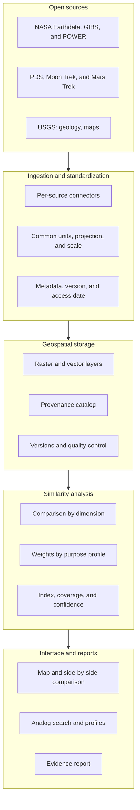

# PlanetLog

A geospatial intelligence platform for identifying, analyzing, and comparing terrestrial environments analogous to the Moon and Mars.

**Members:**

Danilo Bomfim Moreira Junio
Leonardo Pimentel Santos de Araujo
Luan Morais Galdino
Lucas Oliveira Duarte
Matheus Machado de Oliveira

## Summary

PlanetLog is a geospatial intelligence platform that identifies, analyzes, and compares terrestrial environments with characteristics similar to those of the Moon and Mars. It integrates open data from NASA, USGS, and partner institutions into a single analytical environment, cross-referencing geology, mineralogy, topography, temperature, water, and surface processes.

The result is an explainable comparison: for each pairing of a terrestrial region and a planetary target, the platform presents the degree of similarity, the evidence used, the divergences, and the confidence level. The target audience includes researchers, students, aerospace development teams, and enthusiasts, and the purpose is to support the preparation of future robotic and human exploration missions.

## 1. Introduction

### 1.1 Context and motivation

Exploring the Moon and Mars requires validating equipment, protocols, and scientific hypotheses before probes, rovers, or crews are sent. Terrestrial analogs, regions of Earth that share geological, mineralogical, topographic, or climatic traits with planetary surfaces, serve as low-cost, easily accessible natural laboratories.

There is, however, an information bottleneck. The orbital and environmental data required are freely available but scattered across heterogeneous databases, in complex technical formats that are difficult to integrate. Without tools that consolidate and cross-reference these parameters, the systematic search for analogs is restricted to those who master geospatial data processing.

### 1.2 The solution

PlanetLog structures scientific data from open sources into a unified analytical environment. By cross-referencing variables such as geology, mineralogy, topography, temperature, presence of water, and environmental conditions, the platform evaluates the degree of similarity between terrestrial locations and extraterrestrial targets of interest.

### 1.3 General objective

To transform raw scientific data into visual, structured, and accessible information, democratizing planetary geospatial analysis and offering technical and scientific support for the identification of analog environments and the planning of space exploration missions.

### 1.4 Organization of this document

- **Section 2 — Objectives:** general and specific goals of the platform.
- **Section 3 — Scientific foundations:** the concept of a planetary analog, lunar and Martian environments, comparison dimensions, and limitations.
- **Sections 4 and 5 — Methodology and data sources:** the analytical process and the databases used.
- **Sections 6 and 7 — Architecture and features:** technical structure and usage flow.
- **Sections 8 to 10 — Case study, similarity classification, and validation:** application, scoring method, and evaluation criteria.
- **Sections 11 and 12 — Limitations, future work, and conclusion.**

## 2. Objectives

PlanetLog must integrate scientific data into a single environment and use them to identify terrestrial regions analogous to the Moon and Mars, showing the evidence for each match and the differences that limit it.

### 2.1 General objective

To develop a geospatial intelligence platform capable of identifying and comparing terrestrial environments with characteristics similar to those of a target celestial body, using geological, mineralogical, topographic, and environmental data from NASA and partner institutions.

### 2.2 Specific objectives

1. **Integrate and centralize scientific data.** Gather satellite imagery, digital elevation models, climate data, geological records, mineralogical information, and observations from space missions, reducing fragmentation across databases.
2. **Characterize terrestrial environments.** Describe each region by its geology, mineralogy, topography (elevation, slope, roughness), temperature, availability of water and ice, dust and wind, and habitability conditions.
3. **Compare terrestrial and planetary environments.** Use compatible scientific indicators to show in which dimensions a terrestrial region works as an analog, recognizing that strong geological similarity may coexist with atmospheric, thermal, or physical differences.
4. **Identify potential analogs based on evidence.** Go beyond visual comparison, supporting scientific studies, technology tests, and mission preparation.
5. **Calculate and explain similarity.** When data are sufficient and methodologically compatible, apply statistical metrics, always exposing criteria, variables, weights, and limitations, with no classifications lacking scientific grounding.
6. **Visualize and interpret geospatial information.** Offer maps, layers, images, indicators, and side-by-side comparisons that show the spatial distribution of the characteristics analyzed.

## 3. Scientific foundations

An analog environment is a region of Earth that reproduces, in part, characteristics of another celestial body. PlanetLog is based on the premise that an analogy is always partial and must be evaluated dimension by dimension.

### 3.1 Planetary analog environments

Analogs are used to study natural processes, test instruments, develop technologies, and simulate the conditions of future missions. Direct exploration of other bodies involves high cost, risk, and technological limitations; on Earth it is possible to conduct fieldwork, collect samples, and test equipment under controlled or partially similar conditions.

An analog need not reproduce all conditions of the target. A region may resemble Mars in aridity, mineralogy, and the presence of salts and yet differ in atmospheric pressure, gravity, and radiation. A volcanic region may serve the study of lunar terrains even though it does not reproduce the space environment. The usefulness of a site depends on the research objective: it may be suitable for testing a sampler and unsuitable for simulating the Martian thermal regime.

NASA already uses terrestrial environments for this purpose. The Atacama Desert in Chile is studied for its extreme aridity and the low presence of microorganisms in certain areas, which allows investigation of the limits of microbial survival and the testing of technologies for biosignature detection. Volcanic terrains serve geological training and equipment evaluation.

### 3.2 The Moon and Mars compared with Earth

| Characteristic                       | Moon                                             | Mars                                                                        | Earth                                                       |
| ------------------------------------ | ------------------------------------------------ | --------------------------------------------------------------------------- | ----------------------------------------------------------- |
| Atmosphere                           | Extremely tenuous exosphere                      | Very thin, predominantly CO₂                                                | Dense, predominantly N₂ and O₂                              |
| Surface gravity (approx.)            | 1/6 of Earth's                                   | about 38% of Earth's                                                        | reference                                                   |
| Surface temperature (NASA reference) | about 127 °C (day) to −173 °C (night)            | about 20 °C to −153 °C                                                      | varies by climate                                           |
| Water                                | Ice in permanently shadowed craters at the poles | Polar and subsurface ice; liquid water in the past                          | Abundant and liquid                                         |
| Surface                              | Basaltic maria, highlands, regolith, and craters | Basalts, iron oxides, clays, sulfates, dunes, valleys, and ancient channels | Dynamic, modified by water, wind, vegetation, and tectonics |
| Radiation protection                 | Practically none                                 | Limited                                                                     | High (atmosphere and magnetic field)                        |

Temperature values depend on location, season, and time of day, and should be treated as order-of-magnitude references.

### 3.3 Lunar characteristics relevant to analogs

- **Geology and materials:** the maria are plains of ancient basaltic flows, and the highlands have a distinct composition and history. The regolith, formed by successive impacts and exposure to the space environment, has its own properties and is not equivalent to terrestrial soil.
- **Topography:** craters, basins, slopes, and irregular terrain influence landing and mobility; elevation, slope, roughness, and crater density are the key parameters.
- **Temperature and illumination:** with no atmosphere, the variation between illuminated and shadowed areas is extreme, and illumination is a planning factor for bases.
- **Water and ice:** evidence of volatiles in permanently shadowed craters at the poles; their presence, quantity, and the possibility of extraction still depend on confirmation.
- **Operations:** terrain stability, obstacles, illumination, and potential resources condition the choice of landing and installation sites.

Volcanic basalts, areas with fragmented material, and cold, rocky terrains on Earth help test equipment and procedures, without reproducing vacuum or space exposure.

### 3.4 Martian characteristics relevant to analogs

- **Geology and mineralogy:** basalts, oxidized iron minerals (the origin of the reddish coloration), clays, sulfates, and sedimentary deposits. The presence of the same mineral at two locations does not imply the same origin; geological context and formation and alteration processes must be considered.
- **Topography and geomorphology:** craters, plains, volcanoes, canyons, dunes, valleys, and ancient channels. Elevation, slope, roughness, and the distribution of craters, rocks, and obstacles guide landing and navigation.
- **Temperature and climate:** low temperatures, with large variation across locations, seasons, and times of day; the rarefied atmosphere retains little heat. Temperature alone is not a complete analog, since pressure, gas composition, radiation, and humidity also matter.
- **Water and ice:** there is evidence of ancient rivers, deltas, and lakes. Today water occurs mostly as polar and subsurface ice, and the thin atmosphere makes stable liquid water difficult.
- **Dust, wind, and atmospheric processes:** particle transport, dunes, and dust storms affect visibility, instruments, mechanical systems, and power generation. Terrestrial deserts allow the study of transport and erosion, but the dynamics occur in a much denser atmosphere.
- **Biology and habitability:** conditions similar to those of Mars are not evidence of life on Mars. Extreme terrestrial environments serve as an experimental reference for developing methods and interpreting mission results.
- **Subsurface environments:** caves, fractures, and lava tubes may preserve ice, minerals, and ancient records, and offer partial protection against radiation and thermal variation.

### 3.5 Comparison dimensions

Similarity is evaluated across eight dimensions, never by visual appearance or by a single variable.

| Dimension                         | Variables considered                                                                                                    | Methodological caution                                                     |
| --------------------------------- | ----------------------------------------------------------------------------------------------------------------------- | -------------------------------------------------------------------------- |
| Geology and mineralogy            | Rock and mineral types, chemical composition, basalts, clays, sulfates, salts, volcanic structures, craters, weathering | The same mineral does not imply the same genesis                           |
| Topography and geomorphology      | Elevation, slope, roughness, relief, craters, dunes, valleys, obstacles                                                 | Compare at the same spatial scale                                          |
| Temperature and extremes          | Mean, maximum, minimum, amplitude, daily and seasonal variation, solar exposure                                         | Do not compare air temperature with surface temperature without adjustment |
| Water, ice, and volatiles         | Surface water, ice, permafrost, soil moisture, evaporites, subsurface reserves                                          | Water presence does not imply the same preservation mechanism              |
| Dust, wind, and surface processes | Wind, sediment transport, erosion, dunes, suspended particles                                                           | Differences in atmospheric pressure and density                            |
| Biology and habitability          | Microorganisms, extremophiles, salinity, radiation, pH, organic matter, biosignature preservation                       | Experimental analogy, not evidence of life                                 |
| Caves and subsurface              | Lava tubes, fractures, cavities, ice, sedimentary layers, stability, and access                                         | Access and stability vary by site                                          |
| Operational conditions            | Landing and traverse, slope, obstacles, visibility, communication, navigation, resources, safety                        | Depends on the type of mission being tested                                |

### 3.6 Terrestrial environments of interest

| Environment                          | Main utility                                                                                                                           | Limit of the analogy                                                                                                  |
| ------------------------------------ | -------------------------------------------------------------------------------------------------------------------------------------- | --------------------------------------------------------------------------------------------------------------------- |
| Atacama Desert (Chile)               | Extreme aridity, salinity, strong solar exposure, evaporitic minerals, limits of microbial life, testing of life-detection instruments | Atmosphere, gravity, pressure, gas composition, and radiation differ from Mars; partial analog                        |
| McMurdo Dry Valleys (Antarctica)     | Cold and aridity, freezing and sublimation, preservation of materials, extreme microbiology, testing at remote sites                   | Does not reproduce the pressure, atmosphere, or gravity of Mars                                                       |
| Volcanic regions of Iceland          | Lava fields and basalts, robot mobility, mineralogical identification, volcanic relief                                                 | Interaction with water and atmosphere differs from lunar and Martian conditions                                       |
| Mauna Kea and the Hawaiian volcanoes | Basaltic lavas, rock fields, high altitude; geological training of Apollo-program astronauts                                           | Humid environment and active erosion                                                                                  |
| Terrestrial impact craters           | Impact morphology, rock deformation, associated deposits                                                                               | Water, wind, vegetation, and tectonics alter the structures, whereas many lunar craters are preserved for much longer |

### 3.7 Application to space exploration

Analog environments allow testing of robotic mobility (rocks, slopes, sand, dunes), sample collection and analysis instruments, sensors and navigation systems, environmental monitoring technologies, and procedures for human operations at remote locations. In doing so, they reduce scientific and operational uncertainties before real missions.

### 3.8 Limitations of analogs

No terrestrial environment fully reproduces the Moon or Mars. The main differences lie in gravity, atmosphere (pressure, heat transfer, wind, particle propagation), radiation, thermal mechanisms, and geological and environmental processes, since on Earth water, atmosphere, vegetation, and tectonics continuously modify the surface. Every analogy must therefore be stated specifically: what is similar, what is different, and for which application the site is useful.

## 4. Methodology

The methodology compares a terrestrial region and a lunar or Martian region by measurable variables, in seven steps ranging from the selection of areas to scientific interpretation. Comparison by visual appearance is discarded, since similar-looking landscapes can have very different compositions and processes.

1. **Selection of regions of interest.** Define the terrestrial area and the lunar or Martian region to be compared, in specific subsets and never in large areas treated as homogeneous.
2. **Data collection.** Obtain geological, mineralogical, topographic, thermal, and environmental variables from the sources in Section 5.
3. **Standardization.** Convert data to compatible units, spatial scales, projections, and periods, recording the resolution, acquisition method, and uncertainty of each layer.
4. **Analysis by dimension.** Compare each of the eight dimensions in Section 3.5 separately.
5. **Identification of correspondences.** Record the variables with relevant similarity.
6. **Identification of divergences.** Record the variables with no correspondence or with significant differences, including those inherent to Earth (gravity, atmosphere, radiation).
7. **Scientific interpretation.** Evaluate for which research or testing purpose the site is useful, presenting evidence, limitations, and confidence level.

### 4.1 Principles

- **Multidimensionality:** no conclusion is based on a single variable.
- **Traceability:** each result points to the source, the data version, and the access date.
- **Compatibility:** equivalent variables are compared with each other, for example surface temperature with surface temperature.
- **Transparency:** criteria, weights, missing data, and uncertainties are always displayed alongside the result.
- **Missing data is not zero:** the lack of information does not mean the absence of the characteristic.

## 5. Data sources

PlanetLog uses open NASA and USGS databases that cover Earth, the Moon, and Mars. Each dataset has its own spatial and temporal resolution, unit, acquisition method, and limitations, which must be verified before any comparison.

| Source                           | Coverage              | Use in PlanetLog                                                                  |
| -------------------------------- | --------------------- | --------------------------------------------------------------------------------- |
| NASA Earthdata                   | Earth                 | Earth observation datasets: relief, temperature, humidity, surface cover          |
| NASA Worldview                   | Earth                 | Visualization of imagery and environmental layers                                 |
| NASA GIBS                        | Earth                 | Distribution service for imagery and geospatial layers for the map                |
| NASA POWER                       | Earth                 | Meteorological and solar-energy variables, for the thermal and wind regime        |
| NASA Planetary Data System (PDS) | Moon and Mars         | Scientific data from planetary missions: mineralogy, topography, temperature, ice |
| Moon Trek                        | Moon                  | Visualization and querying of lunar data and features                             |
| Mars Trek                        | Mars                  | Visualization and querying of Martian data and features                           |
| USGS                             | Earth, Moon, and Mars | Geological, topographic, and cartographic information                             |

### 5.1 Dataset acceptance criteria

- Institutional origin and public documentation of the acquisition method.
- Declared spatial and temporal resolution, adequate to the scale of the comparison.
- Known and convertible units and geodetic references.
- A license that permits use and redistribution of derivatives.

The addresses and versions of each dataset must be recorded in the references section at the end of the implementation.

## 6. System architecture

PlanetLog is organized into five layers, each consuming only the output of the previous one, so that every result can be traced back to the source and the version of the data.

Data arrive standardized and versioned, the engine compares by dimension, and every index is accompanied by coverage and confidence.

### 6.1 Layers and responsibilities

The technologies below are candidates and must be confirmed by the team during the implementation phase.

| Layer                         | Responsibility                                                                            | Candidate technologies                                      |
| ----------------------------- | ----------------------------------------------------------------------------------------- | ----------------------------------------------------------- |
| Open sources                  | Provide data for Earth, the Moon, and Mars                                                | NASA, USGS, and partner institutions                        |
| Ingestion and standardization | Collect via connectors, convert units, projection, and scale, record metadata and version | Python with GDAL and rasterio; catalog in the STAC standard |
| Geospatial storage            | Store raster and vector layers, provenance catalog, and quality control                   | PostgreSQL with PostGIS; Cloud-Optimized GeoTIFF (COG)      |
| Similarity analysis           | Comparison by dimension, profile weights, index, coverage, and confidence (Section 9)     | Python with NumPy, SciPy, and scikit-learn                  |
| Interface and reports         | Maps, side-by-side comparison, analog search, and evidence report, via API                | REST API; MapLibre GL JS or CesiumJS for maps and globes    |

### 6.2 Design principles

- **Traceability:** each data layer stores its origin, version, and access date.
- **Reproducibility:** the same dataset and the same weight configuration produce the same result.
- **Explainability:** the index is never displayed without variables, weights, coverage, and confidence.
- **Extensibility:** new sources enter through connectors and new planetary targets through new sets of layers, without changing the analysis engine.

## 7. Features and usage flow

The user chooses a terrestrial region and a planetary target, and the platform returns maps, indicators, and a comparison explained by dimension.

### 7.1 Features

| Feature                 | Description                                                                                                                         |
| ----------------------- | ----------------------------------------------------------------------------------------------------------------------------------- |
| Data catalog            | Unified query of the sources in Section 5, with origin, resolution, unit, and date of each layer                                    |
| Geospatial exploration  | Interactive map with layers of elevation, slope, temperature, mineralogy, ice, and satellite imagery, for Earth, the Moon, and Mars |
| Region characterization | Sheet for an area with the eight dimensions of Section 3.5 and the data available in each                                           |
| Side-by-side comparison | Two regions, one terrestrial and one planetary, in synchronized panels, with aligned variables                                      |
| Analog search           | Given a lunar or Martian region, lists candidate terrestrial regions ranked by similarity                                           |
| Purpose profiles        | Preset weights by objective (astrobiology, mobility, geology), adjustable by the user                                               |
| Evidence report         | Export with correspondences, divergences, limitations, data coverage, and confidence level                                          |

### 7.2 Usage flow

1. Choose the target (Moon or Mars) and, if desired, a specific region of it.
2. Choose or draw the terrestrial region, or ask the platform to search for candidates.
3. Select the purpose profile and, optionally, adjust weights and included dimensions.
4. View the map and the side-by-side comparison, dimension by dimension.
5. Read the result: similarity by dimension, global index, data coverage, and confidence.
6. Open the evidence and divergences, and export the report.

## 8. Case study: Atacama and Mars

The case study compares specific areas of the Atacama Desert with regions of Mars to show that the same site can be a good analog in some dimensions and a weak one in others. The Atacama is not treated as a homogeneous environment: the case uses subsets, such as hyperarid areas and saline deposits, defined in the selection phase.

### 8.1 Case design

1. Delimit two or three areas of the Atacama and one or more Martian regions of interest with comparable mineralogy and relief.
2. Gather the data for each dimension and standardize them according to Section 4.
3. Calculate the similarity by dimension, the global index, the coverage, and the confidence (Section 9).
4. Record correspondences and divergences and produce the evidence report.

### 8.2 Expectation by dimension

The expectation below stems from the scientific foundations and works as a hypothesis to be tested, not as a result.

| Dimension                          | Expected analogy | Justification                                                                |
| ---------------------------------- | ---------------- | ---------------------------------------------------------------------------- |
| Biology and habitability           | Strong           | Extreme aridity and low microbial activity in specific areas                 |
| Water, ice, and volatiles          | Medium to strong | Low water availability and evaporitic deposits                               |
| Geology and mineralogy             | Medium to strong | Salts, evaporites, and iron minerals; depends on the area                    |
| Dust, wind, and surface processes  | Medium           | Strong aeolian action, but in a much denser atmosphere                       |
| Temperature and extremes           | Medium to weak   | High aridity and solar radiation, but thermal amplitude smaller than Martian |
| Operational conditions             | Medium           | Terrains suitable for mobility and instrument tests                          |
| Atmosphere, gravity, and radiation | Weak             | Inherent to Earth and not replicable on site (Section 3.8)                   |

### 8.3 Expected outputs

Maps of the areas, a similarity profile by dimension, an evidence report, and a recommendation for use of the Atacama by purpose, for example testing life-detection instruments rather than testing thermal behavior.

## 9. Similarity classification system

Similarity is calculated by dimension and then aggregated into a global index, which always comes accompanied by data coverage and confidence. The index is an estimate within the variables and criteria used, never a proof of equivalence between environments. The weight and range values below are initial proposals, to be calibrated during validation (Section 10).

### 9.1 Similarity by variable and by dimension

Each variable k is normalized to the interval [0, 1] on a reference scale common to both environments, and its similarity is the complement of the normalized distance. The similarity of a dimension d is the weighted mean of the variables with available data.

$$
s_k = 1 - \min\left(1, \frac{|x_k^{T} - x_k^{P}|}{r_k}\right)
\qquad
S_d = \frac{\sum_{k \in K_d} v_k \, s_k}{\sum_{k \in K_d} v_k}
$$

Here $x_k^T$ and $x_k^P$ are the values of the variable in the terrestrial and planetary regions, $r_k$ is the reference range of the variable, and $K_d$ is the set of variables of dimension $d$ with available data. Categorical variables, such as rock or mineral type, use matching by class or by hierarchy.

### 9.2 Global index, coverage, and confidence

$$
S = \frac{\sum_{d \in D^{*}} w_d \, S_d}{\sum_{d \in D^{*}} w_d}
\qquad
C = \frac{\sum_{d \in D^{*}} w_d}{\sum_{d \in D} w_d}
$$

$D^*$ is the set of dimensions with sufficient data, $D$ is the set of the eight dimensions, and $w_d$ is the weight of the dimension. $S$ ranges from 0 to 1, and $C$ is the coverage: the fraction of the total weight actually evaluated.

Handling rules:

- **Missing data is not zero.** The dimension or variable is removed from the calculation and reduces the coverage C.
- **Minimum coverage.** Below a threshold of C (initial proposal: 0.5) the global index is not displayed, only the results by dimension.
- **Confidence** per dimension combines spatial resolution, scale and period compatibility, data quality, and uncertainty, and is displayed as high, medium, or low.
- **Non-replicable factors**, such as gravity, atmospheric pressure, and radiation, do not enter the score; they are listed as mandatory divergences in every report.

### 9.3 Weights by purpose profile

The relative weights (3 = high, 2 = medium, 1 = low) express the importance of each dimension for the objective of the comparison and can be adjusted by the user.

| Dimension                         | Astrobiology | Mobility and operations | Geology and mineralogy |
| --------------------------------- | ------------ | ----------------------- | ---------------------- |
| Geology and mineralogy            | 2            | 1                       | 3                      |
| Topography and geomorphology      | 1            | 3                       | 2                      |
| Temperature and extremes          | 2            | 2                       | 1                      |
| Water, ice, and volatiles         | 3            | 1                       | 2                      |
| Dust, wind, and surface processes | 2            | 2                       | 2                      |
| Biology and habitability          | 3            | 1                       | 1                      |
| Caves and subsurface              | 1            | 2                       | 2                      |
| Operational conditions            | 1            | 3                       | 1                      |

### 9.4 Interpretation ranges

| Index S      | Interpretation                                  |
| ------------ | ----------------------------------------------- |
| 0.75 to 1.00 | Strong analogy in the dimensions evaluated      |
| 0.50 to 0.74 | Partial analogy; check the divergent dimensions |
| Below 0.50   | Weak analogy for the chosen purpose             |

The interpretation is valid only together with C and the confidence: a high S with a low C indicates little evidence, not a good analogy.

## 10. Results and validation

This section defines how PlanetLog will be evaluated; the measured results must be recorded here after the case study in Section 8 is executed. No numerical result is declared before that.

### 10.1 Validation plan

| Level       | What is verified                                                                 | Method                                                                                                                                   |
| ----------- | -------------------------------------------------------------------------------- | ---------------------------------------------------------------------------------------------------------------------------------------- |
| Data        | Integrity, units, georeferencing, and scale compatibility                        | Automated tests at ingestion; comparison of samples with the original source                                                             |
| Calculation | Correctness of the formulas in Section 9 and behavior with missing data          | Unit tests with synthetic cases of known result; verification that missing data reduces C and not S                                      |
| Scientific  | Agreement with analogs already recognized by the literature and by NASA          | Reference pairs (for example Atacama and Mars, McMurdo and Mars, Hawaii and Moon) must score above pairs with no geological relationship |
| Sensitivity | Stability of the ranking under changes in weights, resolution, and normalization | Systematic variation of parameters and analysis of the change in position                                                                |
| User        | Clarity of the evidence and usefulness for the purpose                           | Evaluation with researchers and students, with search and interpretation tasks                                                           |

### 10.2 Acceptance criteria

- Every index displayed carries the variables used, the sources, the coverage C, and the confidence.
- Positive reference pairs consistently outperform negative control pairs across the weight ranges tested.
- The ranking of candidates does not invert under reasonable weight variations in the default profiles.
- Mandatory divergences (gravity, atmosphere, radiation) appear in every report.
- Every result is reproducible from the recorded version of the data.

### 10.3 Results log

The case study results, validation metrics, and adjustments to weights and ranges will be recorded in this subsection, with date, data version, and responsible person.

## 11. Limitations and future work

The main limitation is that the platform depends on the quality, resolution, and compatibility of data from different origins; the analysis must therefore consider specific regions and never treat large geographic areas as homogeneous environments.

### 11.1 Limitations

- **Partial analogy:** no terrestrial environment reproduces the gravity, atmosphere, and radiation of other bodies (Section 3.8).
- **Uneven coverage:** Earth has much denser data than the Moon and Mars, and some dimensions (biology, subsurface) have little planetary observation.
- **Resolution and scale:** datasets with different spatial and temporal resolutions limit direct comparison.
- **Subjectivity of weights:** the index depends on the weights and ranges chosen, which is why they are exposed and adjustable.
- **The index is not proof:** the result indicates similarity in the variables used, not equivalence of the environments.

### 11.2 Future work

- Expand Earth coverage to polar and saline regions, subsurface systems, and other volcanic terrains.
- Include more targets in the Solar System, such as moons of the outer planets, when compatible data are available.
- Add statistical and machine-learning methods, such as multivariate distances and clustering, while maintaining explainability.
- Estimate uncertainty probabilistically and propagate it to the index.
- Integrate field data and data from partner institutions, with expert review.
- Offer a public API and export to GIS tools.
- Evolve the catalog toward landing-site and base-siting planning, with route and illumination analysis.

## 12. Conclusion

PlanetLog proposes to make accessible a task that today is restricted to specialists: finding on Earth environments that help understand and explore the Moon and Mars. By integrating open data, comparing across dimensions, and exposing evidence, divergences, and confidence, the platform avoids the error of treating visual similarity or an isolated index as proof of equivalence.

The scientific goal is not to claim that a terrestrial site is identical to an extraterrestrial region, but to show how specific characteristics of our planet contribute to understanding other worlds and developing exploration technologies.

## References

Institutional sources used as a data basis and for scientific grounding. Before publication, record for each one the dataset version, the access date, and the exact address.

- NASA Earthdata (earthdata.nasa.gov) and NASA Worldview (worldview.earthdata.nasa.gov).
- NASA GIBS, Global Imagery Browse Services.
- NASA POWER, Prediction Of Worldwide Energy Resources (power.larc.nasa.gov).
- NASA Planetary Data System, PDS (pds.nasa.gov).
- NASA Moon Trek and Mars Trek (trek.nasa.gov).
- USGS, United States Geological Survey (usgs.gov), including the astrogeology program.
- Scientific literature on planetary analogs, the Atacama, the McMurdo Dry Valleys, Iceland, and Hawaii, to be included according to the case studies.
