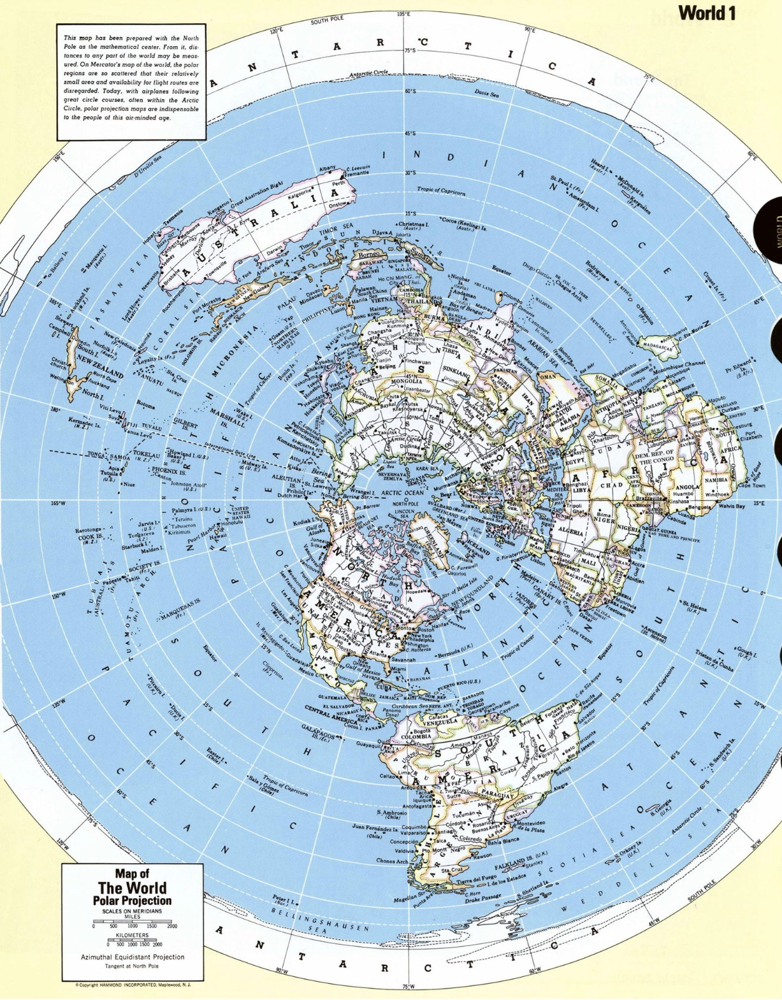

# Apresentação

## Hélio-3

**Contexto:**
O isótopo de hélio-3 é um combustívelpra fusão nuclear. A china está mapeando a concentração desse material na atmosfera
e superfície lunar e se recusa a apresentar esses dados publicamente. A NASA tem interesse nesses dados.

[Gazeta do Povo - China busca garantir domínio sobre o hélio-3 da Lua, a “energia do futuro”](https://www.gazetadopovo.com.br/mundo/china-busca-garantir-dominio-sobre-o-helio-3-da-lua-a-energia-do-futuro/)

**Ideia:**

Aproveitar o sistema de detecção de condições analogas e aprendizado de máquina pra identifiar padrões geográficos associados às concentrações
de hélio 3 na atmosfera e superficie terrestre pra construir uma IA capaz de identificar concentrações presentes na lua.